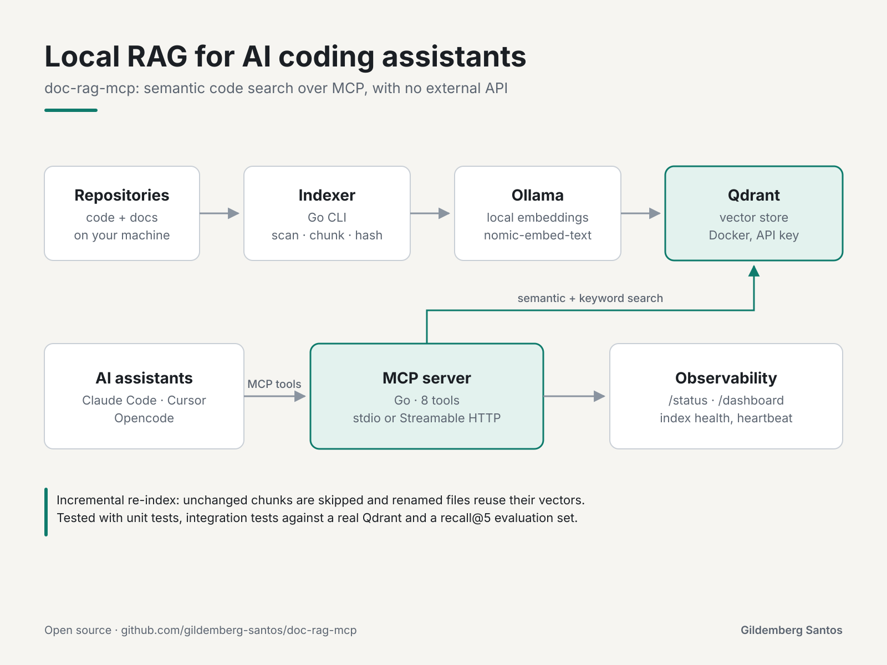

# doc-rag-mcp — Local RAG documentation server over MCP (Go + Qdrant + Ollama)

[Português](README.pt-BR.md)

An **MCP** server that makes your projects' code and documentation searchable by any LLM client through **RAG**. It scans your repositories, splits them into chunks, generates embeddings with a **local Ollama** model (no external API, no API key), stores them in **Qdrant** (local, via Docker) and exposes semantic search as **MCP tools** for Claude Code, Opencode, Cursor and other clients.



## Architecture

```
┌──────────────┐   indexes   ┌──────────┐  embeddings  ┌───────────┐
│  my-api      │ ──────────▶ │ indexer  │ ───────────▶ │  Qdrant   │
│  my-web-     │   chunks    │ (Go CLI) │  Ollama     │ (Docker,  │
│  client      │             │          │  nomic-     │  :6333)   │
└──────────────┘             └──────────┘  embed-text └─────┬─────┘
                                                              │ search
┌────────────┐  MCP tools   ┌───────────────┐  query vec     │
│ Claude     │ ◀─────────── │  mcp-server   │ ─────────────┘
│ Opencode   │  stdio or    │  (Go, tools:  │
│ ...        │  Streamable  │  search_docs, │
└────────────┘  HTTP /mcp   │  get_document,│
                            │  list_*, ...) │
                            └───────────────┘
```

**MCP tools:**

| Tool | Description |
|---|---|
| `search_docs` | Semantic + keyword search (`query`, `project?` comma-separated for cross-project, `top_k?` max 50, `diversify?`, `max_per_file?`, `path_prefix?`, `language?`, `pure_vector?`) |
| `grep_docs` | Literal inventory: every file containing the term + occurrences (`pattern`, `project?`, `path_prefix?`, `limit?` max 500) |
| `get_document` | Full file (`project`, `path`, `offset?`, `limit?` max 500 — pages large files instead of dumping 200 KB at once) |
| `get_file_doc` | LLM-generated documentation for a file (`project`, `path`), flagged as possibly containing errors |
| `search_file_docs` | Semantic search over the generated docs (`query`, `project?`, `top_k?` max 20, `path_prefix?`) — best for "what does this module do" |
| `list_projects` | Projects + counts + last indexing date |
| `list_docs` | Files in a project (`project`, `limit?`, `prefix?`), marked `· generated doc` when one exists |
| `index_status` | Server (name + version), provider, collection, dims, total points + generated-doc coverage |

**How to search well (lessons from comparing MCP search with grep):**

- `search_docs` to understand a pattern (ranking with per-file diversity + literal match; strong score ≥ 0.55).
- `grep_docs` for a complete inventory (for example, 312 files containing "webhook" in the index vs 354 with `grep -ri`; the gap is files outside the indexing rules).
- Combine them: `grep_docs` to map, then `search_docs` / `get_document` to understand each group.

## Quickstart (Docker, recommended)

Mount the repositories you want to index under `/projects` in `docker-compose.yml`, then:

```bash
cd doc-rag-mcp
cp .env.example .env              # no external key — everything is local
docker compose up -d --build      # starts qdrant + ollama + mcp-server
docker compose exec ollama ollama pull nomic-embed-text   # or: make ollama-pull
docker compose run --rm indexer --all   # indexes every project under /projects
curl localhost:8080/health
curl "localhost:8080/search?q=how+does+authentication+work"
# Qdrant UI: http://localhost:6333/dashboard
```

## Local use (no Docker for the binaries; Qdrant still in Docker)

```bash
docker run -p 6333:6333 qdrant/qdrant:latest &   # or: docker compose up qdrant
cp .env.example .env
go mod tidy
go run ./cmd/indexer --all                      # PROJECTS_ROOT=/path/to/your/projects
go run ./cmd/server --transport http --http-addr :8080
```

## Connecting LLM clients

### Claude Code (local stdio — needs the binary and a reachable Qdrant)

```bash
go build -o ~/.local/bin/doc-rag-mcp ./cmd/server
claude mcp add doc-rag -- ~/.local/bin/doc-rag-mcp --transport stdio
# with env:
QDRANT_URL=http://localhost:6333 OLLAMA_URL=http://localhost:11434 ~/.local/bin/doc-rag-mcp --transport stdio
```

Or over HTTP (with the Docker server running):

```bash
claude mcp add -t http doc-rag http://localhost:8080/mcp
```

### Opencode (`opencode.json`)

```json
{
  "mcp": {
    "doc-rag": {
      "type": "remote",
      "url": "http://localhost:8080/mcp",
      "enabled": true
    }
  }
}
```

For stdio in Opencode:

```json
{
  "mcp": {
    "doc-rag": {
      "type": "local",
      "command": ["/home/user/.local/bin/doc-rag-mcp", "--transport", "stdio"],
      "enabled": true,
      "environment": {
        "QDRANT_URL": "http://localhost:6333",
        "OLLAMA_URL": "http://localhost:11434"
      }
    }
  }
}
```

See `examples/opencode.json` and `examples/claude.json`.

### Any Streamable HTTP client

Endpoint: `POST http://localhost:8080/mcp` (MCP Streamable HTTP).
REST debug endpoint (no MCP): `GET /search?q=...&project=...`.

## Re-indexing

```bash
# everything (collection "docs", local Ollama), incremental by default (diff only):
docker compose run --rm indexer --all
# a single project:
docker compose run --rm indexer --project my-api --path /projects/my-api
# full re-index (deletes everything first — only for model/dims migrations):
docker compose run --rm indexer --all --clean
# dry run: counts unchanged / to embed / stale without writing anything:
docker compose run --rm indexer --all --dry-run
```

> The default incremental mode compares each chunk's content hash with what is already in Qdrant: unchanged chunks are skipped (no call to the embedding provider), only new or changed chunks are re-embedded, and points from removed, renamed or shortened files are deleted automatically. The first incremental run after upgrading to this version re-embeds the whole index once (old points lack the new ID/hash scheme), which also cleans up any duplicates left by earlier incremental versions.
>
> Changing the model or dimensions (`OLLAMA_MODEL`, `OLLAMA_EMBED_DIMS`) without recreating the collection would mix incompatible vectors, so the incremental run aborts with a `dims mismatch` error. Run once with `--clean`, which recreates the collection automatically.
>
> Embed + upsert batches run in parallel (`--embed-concurrency`, default 4) with retries (3 attempts, backoff). Use `--embed-concurrency 1` for deterministic sequential runs.

Besides the content hash, the indexer avoids even **reading** a file when its mtime, size and chunk count exactly match what is indexed; any real edit (or a previously interrupted re-index) falls back to the normal read path. Chunks whose body already exists in the index (rename/move, shifted or duplicated content) **copy the vector** instead of re-embedding, so a rename costs milliseconds instead of a re-embed. Within a scan, the most recently modified files are processed first.

### Continuous mode (`--watch`)

```bash
# local:
go run ./cmd/indexer --all --watch --interval 10m
# docker (dedicated, opt-in service):
make docker-watch
# or directly: docker compose --profile watch up -d indexer-watch
```

Repeats the incremental indexing every `--interval` (default 10m; also `REINDEX_INTERVAL` in Docker) until Ctrl-C/SIGTERM. Progress already persisted is kept, and the interruption is reported as a clean stop, not a failure. `--watch` always runs incrementally (it ignores `--clean`). This periodic cycle also handles deletions: a file removed from disk has its points removed from Qdrant on the next cycle, with a maximum delay equal to the configured interval. There is no real-time (fsnotify) check.

With `--generate-docs`, the file-docs step runs on the first cycle and then at most every `--docgen-interval` (default 24h, or `$DOCGEN_INTERVAL`; completions are expensive and docs don't need embedding-level freshness), only for `--docgen-projects` (comma-separated, empty = all; `$DOCGEN_PROJECTS`). In Docker the same settings go through `DOCGEN_ENABLED=true`, `DOCGEN_INTERVAL` and `DOCGEN_PROJECTS`:

```bash
# local: docs for 2 projects, at most once a day, alongside a 10-minute watch:
go run ./cmd/indexer --all --watch --generate-docs \
  --docgen-projects my-api,my-web-client --docgen-interval 24h
```

## Local models (Ollama only)

Everything runs locally through Ollama, with no external API and no key: embeddings with `nomic-embed-text` (768 dims) and doc generation with `qwen2.5-coder:7b`. **Important:** the server and the indexer must use the same embedding model, otherwise search finds nothing (different dims). OpenAI support was removed. If you still have an old index (`docs` with 1536 dims), run `indexer --all --clean` once to re-index locally and delete the legacy collections (`docs-ollama*`, if any).

> **GPU:** the Ollama container in the compose file runs on CPU (about 0.40 s per batch of 32, measured) versus about 0.13 s on a host Ollama with GPU, so 3x faster. To index faster, point `OLLAMA_URL` to the host (`http://host.docker.internal:11434` + `extra_hosts: ["host.docker.internal:host-gateway"]`) or run the compose file with NVIDIA passthrough. The default (CPU container) is more isolated and sustains about 260 texts/s with concurrency ≥ 2 (measured; `--embed-concurrency` above 4 does not help). Models stay warm with `OLLAMA_KEEP_ALIVE=24h` (compose default); without it, the first call after 5 idle minutes pays a reload of a few seconds (p50 0.01 s vs measured peaks of 2 s).

```bash
# 1. start everything (qdrant + ollama + server):
docker compose up -d --build
# 2. pull the models (once):
docker compose exec ollama ollama pull nomic-embed-text   # embeddings
docker compose exec ollama ollama pull qwen2.5-coder:7b   # docgen (or: make ollama-pull)
# 3. index:
docker compose run --rm indexer --all
```

> No outbound network in Docker? Copy the models from the host's Ollama (offline, same format): `make ollama-seed` (`HOST_OLLAMA_MODELS=/host/path` if different from the default).

Switching Ollama models (`OLLAMA_MODEL=mxbai-embed-large`) changes the dims (1024) and requires a re-index (`--clean`, the collection is recreated automatically).

## Observability (`/status` + `/dashboard`)

`GET /dashboard` is a live page (same origin, no CDN) that reads `GET /status` every 5 s. Everything it shows comes from real data:

| Level | Section | Real source | Cost |
|---|---|---|---|
| 1 | Collection health (`status`, `optimizer_status`, `segments_count`) | Qdrant `GET /collections/{active}` | no new access |
| 1 | `indexed_vectors_count` vs `points_count` (warning when the diff is > 1000 or > 5%) | same `GET` | — |
| 1 | Orphan collections (e.g. a legacy index from another config) | `GET /collections` + count per collection | — |
| 1 | `dims_mismatch` (model dims vs collection dims become an active warning) | compares `Embedder.Dims()` with `vectors.size` | — |
| 1 | Embedding health (does Ollama respond and have the model?) | cheap ping (`/api/tags`), no embedding generated (30 s cache) | — |
| 1 | Process self-stats (uptime, goroutines, heap) + usage (`/mcp` calls counted via middleware, average latency) | `runtime` + atomic counter | — |
| 2 | `indexer --watch` status (last cycle, duration, failures, next cycle + generated/removed file docs per project) | JSON heartbeat written by the indexer to `INDEXER_STATUS_FILE` (shared `status_state` volume) | 1 extra volume |
| 3 | Project containers (state of each) | Docker Engine API over the Unix socket (`DOCKER_SOCKET`, read-only `GET`s) | **privileged**: mounting the socket gives the container access to the daemon API — opt-in, uncomment the volume in the compose file |
| 3 | History (sparkline of points + requests) | `GET /status/history?n=120` — one sample per real `/status`, in memory + JSONL (`STATUS_HISTORY_FILE`) | built-in rotation: above 5 MB it truncates to the last 20k lines |

Without the shared volume, the indexer section disappears (nothing else breaks). Without the socket, the containers section disappears. Without `STATUS_HISTORY_FILE`, history lives only in memory (720 samples, lost on restart).

Optimizer tuning: every collection the indexer creates starts with `deleted_threshold: 0.1` and `vacuum_min_vector_number: 500` (more aggressive than Qdrant's 0.2/1000 defaults; validated live: 2,690 → 155 pending vectors). Existing collections need a one-time PATCH (`EnsureCollection` intentionally does not change existing collections):

```bash
curl -X PATCH localhost:6333/collections/docs \
  -H 'Content-Type: application/json' \
  -d '{"optimizers_config": {"deleted_threshold": 0.1, "vacuum_min_vector_number": 500}}'
```

## Security and operations

- **HTTP auth (opt-in):** `MCP_AUTH_TOKEN` requires a Bearer token on `/mcp`, `/search`, `/status` and `/dashboard` (`/health` stays open for liveness checks). Without a token, the server warns at boot and serves openly — fine on localhost; do not expose `8080`/`6333` without a token.
- **Qdrant API key ON:** the `qdrant` service requires `QDRANT_API_KEY` (every binary sends the header; the dashboard asks for the key at login). Rotation: `openssl rand -hex 32` into `.env` and restart the whole stack together (a mismatched key means 401 everywhere). Direct debugging: `curl -H "api-key: $QDRANT_API_KEY" localhost:6333/collections`.
- **Backup:** `make backup` creates `backups/qdrant-storage-<date>.tgz` (the Qdrant volume). Automate it with cron if the index is critical (a full re-index takes about 10 min; file docs for large projects take much longer).
- **Binary version:** `make build` writes the git SHA into `index_status` (`1.0.0+a1b2c3d`), so an outdated server is detected without guessing.

## Tests

```bash
make test               # unit tests, no external dependencies (httptest fakes)
make test-integration   # against a real Qdrant (must be running)
make eval               # retrieval golden set (recall@5) against the running server
```

The integration tests (`internal/indexer/integration_test.go`) only run with `RUN_QDRANT_INTEGRATION=1`. They cover the full incremental cycle (hash/mtime diff, streaming with partial persistence, self-healing of an update interrupted midway) against a real Qdrant, in disposable collections deleted at the end of each test.

## Project structure

```
cmd/server         → MCP binary (stdio|http|both)
cmd/indexer        → indexing CLI (--all, --watch, --generate-docs)
internal/chunker   → scan + chunking
internal/embed     → local Ollama (Provider interface)
internal/vector    → Qdrant REST client
internal/indexer   → orchestrates scan → embed → upsert
internal/mcpserver → MCP tools
internal/httpapi   → /health + /search debug
```

## Environment variables

| Var | Default | Description |
|---|---|---|
| `EMBED_PROVIDER` | `ollama` | reserved (only `ollama`; `openai` was removed and returns an explicit error) |
| `OLLAMA_URL` | `http://localhost:11434` | `http://ollama:11434` in compose |
| `OLLAMA_MODEL` | `nomic-embed-text` | local embedding model (768 dims) |
| `OLLAMA_EMBED_DIMS` | `768` | 1024 for mxbai-embed-large |
| `QDRANT_URL` | `http://localhost:6333` | `http://qdrant:6333` in compose |
| `QDRANT_COLLECTION` | `docs` | single collection (file docs use `docs-filedocs`) |
| `PROJECTS_ROOT` | `/projects` | root of the projects |
| `HTTP_PORT` | `8080` | HTTP port |
| `INDEXER_STATUS_FILE` | — | `--watch` heartbeat (skipped if empty) |
| `STATUS_HISTORY_FILE` | — | time-series JSONL (memory only if empty) |
| `DOCKER_SOCKET` | — | opt-in Docker socket (skipped if empty) |
| `COMPOSE_PROJECT_NAME` | — | filters containers by project (empty = all) |
| `DOCGEN_PROVIDER` | `ollama` | reserved (only `ollama`) |
| `DOCGEN_MODEL` | `qwen2.5-coder:7b` | local generation model |
| `DOCGEN_ENABLED` | — | `true` enables the indexer's `--generate-docs` without the flag |
| `DOCGEN_INTERVAL` | `24h` | minimum interval of the file-docs step in `--watch` |
| `DOCGEN_PROJECTS` | — | comma-separated projects with docs in `--watch` (empty = all) |
| `MCP_AUTH_TOKEN` | — | `Authorization: Bearer` required on /mcp, /search, /status, /dashboard (empty = open; /health always open) |

## Automatic per-file documentation (`cmd/docgen` + the `-filedocs` collection)

Besides indexing for search, the project generates **readable documentation per file** (purpose, public API, dependencies, notes) with a local LLM (`qwen2.5-coder:7b`, validated to produce correct docs without inventing). The doc is stored in the `<base>-filedocs` collection (one point per file, vector = embedding of the prose) and served through `get_file_doc` / `search_file_docs`; `list_docs` marks which files have a doc, and `index_status` / `/status` report coverage.

```bash
# one package (stdout + Qdrant):
go run ./cmd/docgen --project demo --path ./internal/indexerstatus
# all projects, saving to a folder (mirrors <project>/<path>.md):
go run ./cmd/docgen --all --out ./generated-docs
# markdown only, without touching Qdrant:
go run ./cmd/docgen --all --store=false --out ./generated-docs
# as an indexer step (after each project's embed + upsert):
go run ./cmd/indexer --all --generate-docs
# dry run (no LLM, no writes):
go run ./cmd/docgen --all --dry-run
```

Rules in v1: same exclusions as the chunker (secrets, lockfiles, binaries); skips files under 20 lines or over 30 KB (`--max-bytes`); concurrency 2 (`--concurrency`); incremental by `source_hash` (only new/changed files are generated; points of deleted files are removed). Every generated doc carries a "LLM content, may contain errors" notice; the raw chunks remain the authoritative source.

## Roadmap

- [x] Automatic per-file documentation — phases 1–4 done: `internal/docgen` (interface + Ollama provider), `internal/filedocs` (`-filedocs` collection, incremental by `source_hash`, `--dry-run`), `cmd/docgen` (CLI), `--generate-docs` flag in `cmd/indexer` (with its own `--docgen-interval`, default 24h, and per-project opt-in `--docgen-projects` in `--watch`), `get_file_doc` / `search_file_docs` tools, `has_doc` in `list_docs`, and coverage in `index_status` / `/status` (including a `/dashboard` section).
- [x] OpenAI removed (local models only) — `internal/embed/openai.go` and `internal/docgen/openai.go` deleted; `EMBED_PROVIDER` defaults to `ollama` (`openai` returns an explicit error); canonical collection `docs` (was `docs-ollama`); legacy OpenAI index (1536 dims) migrated with a `--clean` re-index.
- [x] Hardened incremental reprocessing — 8 items implemented on 2026-10-07 (a prerequisite for docgen): incremental by default (`Clean=false`); visibility of "skipped without reading" vs "same hash" vs "copied"; content-based reuse without re-embedding (rename/move/duplicate); payload index + scroll pagination; embedding with worker pool + retry; abort on dims change; `--dry-run`.
